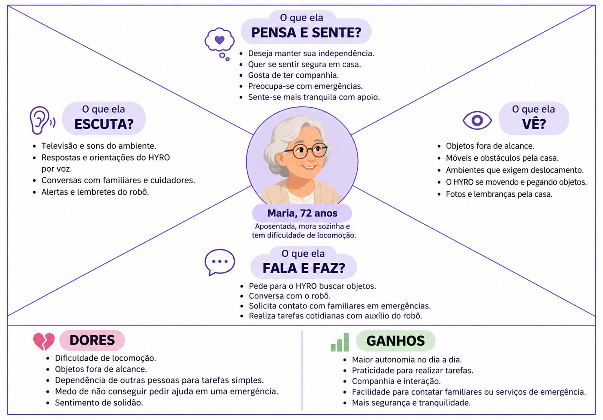
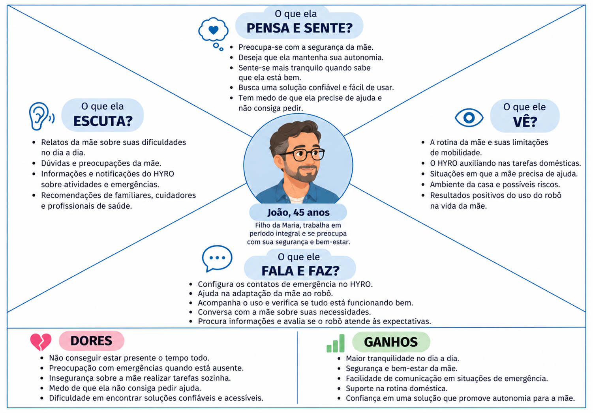
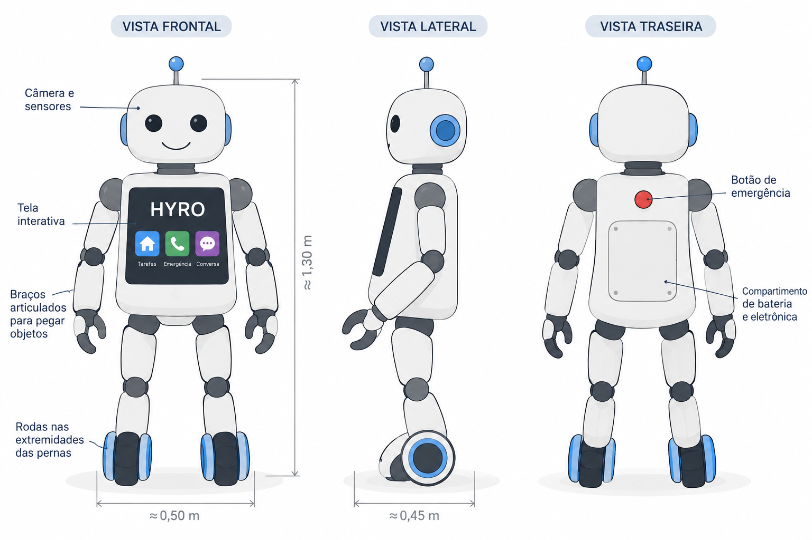

# **HYRO — Robô Híbrido para Assistência Doméstica**

Trabalho de Interação Humano-Robô (IHR) apresentado ao Centro Universitário [FEI](https://portal.fei.edu.br/), como parte dos requisitos necessários para aprovação na disciplina de Interação Humano-Robô (IHR) (CCR230) do curso de Engenharia de Robôs, orientado pelo Prof. Dr. [Fagner de Assis Moura Pimentel](https://github.com/fagnerpimentel).

## Componentes do Grupo

> - Rafaela Botter - 11.122.066-1
> - Letícia Galante - 11.122.071-1
> - Joaquim Jonkel -
> - Rafael Vale -

## Resumo

 O HYRO é um robô de assistência doméstica com estrutura humanoide e rodas nas extremidades das pernas, projetado para auxiliar pessoas com dificuldades na realização de atividades cotidianas, especialmente idosos e pessoas com mobilidade reduzida. Seu diferencial está na combinação de mobilidade, interação por voz e assistência personalizada, permitindo buscar e transportar objetos, oferecer companhia por meio de conversas e disponibilizar uma função de contato de emergência para acionar familiares ou serviços de assistência quando necessário. O HYRO busca proporcionar maior autonomia, segurança e conforto aos usuários, tornando o ambiente doméstico mais acessível e promovendo uma interação intuitiva e acolhedora entre humanos e robôs.

## Introdução

Idosos e pessoas com mobilidade reduzida podem enfrentar dificuldades em tarefas cotidianas, além de situações de isolamento e dificuldade para pedir ajuda em emergências. Nesse contexto, a robótica assistiva pode contribuir para melhorar a autonomia, a segurança e a qualidade de vida dessas pessoas.

O HYRO é um robô de assistência doméstica com estrutura humanoide e rodas nas extremidades das pernas. Por meio de comandos de voz, ele poderá auxiliar na busca e no transporte de objetos, oferecer companhia e facilitar o contato de emergência com familiares ou serviços de assistência.

**Objetivo em uma frase:** promover autonomia, segurança e bem-estar no ambiente doméstico.
**Experiência desejada:** simples, acolhedora e segura, proporcionando uma interação natural e acessível.

## Público-Alvo e Stakeholders

Idosos, pessoas com mobilidade reduzida e indivíduos com dificuldades para realizar tarefas cotidianas, que necessitam de auxílio, companhia e maior segurança no ambiente doméstico.

### Stakeholders

- **Primários** — idosos e pessoas com mobilidade reduzida que utilizam o HYRO para buscar objetos, receber companhia e acionar contatos de emergência.
- **Secundários** — familiares, cuidadores e profissionais de assistência, que podem acompanhar o usuário e receber solicitações de ajuda.
- **Terciários** — demais moradores da residência, profissionais de saúde e serviços de emergência, que podem ser impactados pelo uso do robô e pelo acionamento de seus recursos.

### Personas

- **Persona primária — Maria, 72 anos:** aposentada, mora sozinha e possui dificuldade de locomoção. Utiliza o celular para tarefas básicas, mas prefere comandos de voz por serem mais práticos. Busca ajuda para pegar objetos, ter companhia e contatar familiares em emergências.

- **Persona secundária — João, 45 anos:** filho de Maria, trabalha em período integral e se preocupa com a segurança e o bem-estar da mãe. Deseja que o HYRO ajude nas atividades cotidianas e facilite o contato em situações de emergência.

- **Outras personas — Pessoas com mobilidade reduzida:** usuários de diferentes idades e contextos sociais que necessitam de auxílio em tarefas domésticas e valorizam autonomia, acessibilidade e segurança.

### Informações que o robô deve conhecer

- Nome e preferências de comunicação do usuário.
- Necessidades de acessibilidade e limitações de mobilidade relevantes para a interação.
- Lista de contatos de emergência autorizados.
- Preferências e comandos para as tarefas disponíveis.
- Localização dos objetos e ambientes relevantes, quando necessário.

Essas informações devem ser fornecidas ou autorizadas pelo usuário, respeitando sua privacidade e segurança.

### Mapa de empatia

📄 Persona primária: Maria, 72 anos

- **Vê:** objetos fora de alcance, móveis e ambientes domésticos que exigem deslocamento.
- **Ouve:** sons da casa, televisão e orientações do HYRO por voz.
- **Diz e faz:** pede para o HYRO buscar objetos, conversa com ele e utiliza a função de contato de emergência quando necessário.
- **Pensa e sente:** deseja manter sua independência, sentir-se segura e ter companhia no dia a dia.
- **Dores:** dificuldade de locomoção, necessidade de ajuda em tarefas simples e receio de não conseguir pedir ajuda em uma emergência.
- **Ganhos:** maior autonomia, praticidade, companhia e facilidade para contatar familiares.

📄 Persona secundária: João, 45 anos

- **Vê:** a rotina da mãe, suas dificuldades diárias e o HYRO auxiliando nas tarefas domésticas.
- **Ouve:** relatos da mãe sobre o robô e recebe contatos quando ela precisa de ajuda.
- **Diz e faz:** configura os contatos de emergência, ajuda na adaptação ao robô e verifica se ele atende às necessidades da mãe.
- **Pensa e sente:** preocupa-se com a segurança e o bem-estar da mãe e busca soluções confiáveis para ajudá-la mesmo quando está ausente.
- **Dores:** dificuldade de estar presente o tempo todo e preocupação com possíveis emergências.
- **Ganhos:** maior tranquilidade, apoio à rotina da mãe e facilidade de comunicação em situações que exigem assistência.

## Contexto de uso

O HYRO será utilizado principalmente em ambientes residenciais, como casas e apartamentos, compartilhados por pessoas com diferentes idades e necessidades. O ambiente pode apresentar móveis, corredores estreitos, objetos fora de alcance e obstáculos que dificultam a locomoção. O robô será especialmente útil para idosos e pessoas com mobilidade reduzida, mas poderá auxiliar outros moradores que necessitem de apoio em atividades cotidianas.

O contexto social envolve a convivência entre familiares, cuidadores e moradores, considerando também situações em que o usuário passa períodos sozinho. O HYRO deverá oferecer uma interação acessível por voz, respeitando diferentes níveis de familiaridade com a tecnologia e condições econômicas e culturais.

Antes de iniciar uma tarefa, o robô deverá conhecer o mapa do ambiente, sua localização, os obstáculos e as áreas acessíveis, além das capacidades necessárias para executar a solicitação. Também deverá conhecer as preferências de interação do usuário e, caso a função de emergência esteja habilitada, os contatos previamente cadastrados e autorizados.

## Jornada do usuário

1. O usuário percebe que precisa de ajuda para pegar um objeto fora de alcance.
2. O usuário chama o HYRO por voz, e o robô responde para indicar que está disponível *(verbal)*.
3. O usuário solicita que o robô busque o objeto desejado. Se necessário, o HYRO faz perguntas para esclarecer a solicitação *(verbal)*.
4. O robô confirma o pedido e se desloca pelo ambiente, desviando de móveis, pessoas e outros obstáculos *(espacial)*.
5. Ao chegar ao objeto, o HYRO utiliza seus mecanismos de manipulação para pegá-lo, caso a tarefa seja compatível com suas capacidades *(espacial)*.
6. O robô retorna até o usuário e informa verbalmente que trouxe o objeto, utilizando movimentos ou sinais visuais para indicar sua intenção *(verbal + não-verbal)*.
7. O usuário recebe o objeto e confirma que a tarefa foi concluída. O HYRO permanece disponível para novas solicitações *(verbal)*.
8. Em uma situação de emergência, o usuário poderá solicitar contato com um familiar ou serviço de assistência por meio de um comando específico. O robô confirma a solicitação e inicia o contato conforme as configurações autorizadas *(verbal)*.

Durante a interação, o ambiente poderá apresentar ruídos, circulação de pessoas e obstáculos inesperados. O HYRO deverá adaptar seu deslocamento, comunicar dificuldades e interromper a tarefa quando identificar condições inseguras.

## Análise de concorrência

- **Amazon Astro:** robô doméstico móvel voltado à segurança residencial, monitoramento e interação com moradores. Seu ponto positivo é a navegação autônoma e a integração com recursos de casa inteligente. Como limitação, não foi projetado principalmente para manipular objetos e prestar assistência física a pessoas com mobilidade reduzida.

- **ElliQ:** robô assistivo voltado especialmente ao público idoso, com foco em companhia, conversação, lembretes e promoção do bem-estar. Seu diferencial é a interação social. Como limitação, não possui locomoção doméstica com rodas nem capacidade de buscar e transportar objetos.

- **temi:** robô móvel com interação por voz, navegação autônoma e recursos de telepresença. Seus pontos positivos incluem mobilidade em ambientes internos e comunicação remota. Como limitação, sua configuração padrão não oferece a manipulação de objetos necessária para todas as tarefas propostas para o HYRO.

### Comparação e justificativa

Existem soluções que atendem parcialmente às necessidades do HYRO, principalmente nas áreas de companhia, comunicação, navegação e segurança residencial. Entretanto, essas funcionalidades são frequentemente encontradas em plataformas distintas.

A equipe considera especialmente interessantes o ElliQ, pela interação social e pelo foco no público idoso, e o temi, pela mobilidade e comunicação por voz. O HYRO busca combinar esses aspectos com uma estrutura humanoide e capacidade de manipulação de objetos, além de oferecer uma opção de contato de emergência.

Como alternativa, aplicativos, assistentes virtuais e dispositivos de chamada de emergência podem atender a necessidades específicas com menor custo, mas não oferecem a mesma combinação de mobilidade física, manipulação e interação presencial proposta para o HYRO.

## Design do Robô

### Forma, função e affordances

O HYRO possui uma estrutura humanoide, com cabeça, tronco, braços e pernas com rodas nas extremidades. Sua forma deve comunicar claramente suas funções: os braços indicam a capacidade de pegar objetos, a cabeça representa a percepção do ambiente e a comunicação por voz permite solicitar tarefas sem depender de telas ou controles físicos.

A acessibilidade será considerada por meio de comandos simples, fala clara, volume ajustável e tempo suficiente para o usuário responder. O robô deverá sinalizar suas intenções por voz e movimentos, além de permitir a interrupção de tarefas.

Para seguir o princípio de "prometer menos e entregar mais", o HYRO deverá informar suas capacidades e limitações de forma transparente, sem sugerir que consegue realizar tarefas que não foram implementadas ou testadas.

### Grau de antropomorfismo

O HYRO será posicionado entre os padrões **minimalista e humanoide** no espectro máquina-humano. A presença de cabeça, tronco e braços facilita a compreensão de suas funções e pode tornar a interação mais natural, enquanto as rodas reforçam sua identidade robótica.

O design deverá priorizar uma aparência amigável, sem tentar reproduzir perfeitamente um ser humano. Um rosto simplificado, expressões visuais discretas e movimentos previsíveis ajudam a evitar o vale da estranheza e reduzem expectativas irreais sobre suas capacidades sociais.

### Padrões de design

**1. Apresentação inicial:** o HYRO cumprimenta o usuário, identifica-se e informa brevemente como pode ajudar, permitindo que a pessoa compreenda suas funcionalidades.

**2. Confirmação e feedback:** antes de executar comandos ambíguos ou ações relevantes, o robô confirma a solicitação. Durante a tarefa, informa seu progresso e comunica quando a conclui ou encontra dificuldades.

A combinação desses padrões torna a interação mais previsível e acessível, reduzindo erros de interpretação e aumentando a confiança do usuário no sistema.

### Valores e ética

**Valores:**

- **Autonomia e acessibilidade:** permitir que pessoas com diferentes capacidades físicas interajam com o robô e realizem solicitações sem depender de interfaces complexas.
- **Segurança e privacidade:** proteger o usuário durante a movimentação e manipulação de objetos, respeitando seus dados pessoais e sua autorização para contatos de emergência.

**Risco ético:** o usuário pode confiar excessivamente no HYRO e acreditar que ele garante assistência em qualquer emergência.

**Mitigação:** informar claramente as limitações do sistema, solicitar confirmação antes de acionar contatos quando possível e comunicar se uma chamada não puder ser realizada. O HYRO deverá ser apresentado como um recurso complementar de assistência, e não como substituto de cuidadores ou serviços de emergência.

### Protótipo no papel

O HYRO possui uma estrutura humanoide composta por cabeça, tronco, braços articulados e pernas com rodas nas extremidades, combinando características humanas com mobilidade robótica. A cabeça contém olhos/sensores para percepção do ambiente, além de microfone e alto-falante para comunicação por voz.

O tronco poderá conter uma tela para exibir informações e um botão de emergência para facilitar o acionamento de ajuda. Os braços serão responsáveis por pegar e transportar objetos leves, enquanto as rodas permitirão o deslocamento pelos ambientes domésticos.

O design prioriza uma aparência amigável, movimentos previsíveis e interfaces acessíveis, buscando transmitir segurança e facilitar a interação com diferentes usuários.

As dimensões, os mecanismos de locomoção e a capacidade de manipulação serão definidos conforme a evolução do projeto.

## Ações do robô

**Buscar e entregar objetos** — pré-requisitos: comando de voz compreendido, objeto identificado, caminho acessível e capacidade de manipulação disponível. Ao finalizar: o objeto é entregue ao usuário. Caso não consiga pegá-lo, o HYRO informa a limitação.

**Oferecer companhia** — pré-requisitos: usuário inicia uma conversa ou solicita interação, com o sistema de voz disponível. Ao finalizar: o usuário recebe uma resposta ou pode encerrar a conversa quando desejar.

**Acionar contato de emergência** — pré-requisitos: solicitação do usuário, contato previamente cadastrado e conexão disponível. Ao finalizar: a tentativa de contato é realizada e seu resultado é informado ao usuário.

**Fornecer lembretes** — pré-requisitos: lembrete previamente configurado e horário atingido. Ao finalizar: o usuário recebe o aviso por voz e, se disponível, pela tela.

## Interações do robô

### Espacial

- **Posicionamento:** o HYRO mantém distância suficiente para não invadir o espaço pessoal, aproximando-se somente quando necessário para entregar objetos.
- **Início da interação:** aproxima-se lentamente, preferencialmente pela frente ou por uma direção visível ao usuário, e sinaliza sua intenção por voz ou movimento.
- **Entrega de objetos:** posiciona-se próximo o suficiente para que o usuário alcance o objeto com conforto, sem bloquear passagens.
- **Pessoas e obstáculos:** desvia de pessoas e móveis, evita passar entre indivíduos que estejam conversando e aguarda quando não há espaço seguro para prosseguir.
- **Pré-requisitos:** sensores de proximidade funcionais, espaço de circulação suficiente e rota segura.
- **Resposta emocional esperada:** conforto, segurança e confiança.
- **Adaptação de contexto:** em ambientes estreitos ou compartilhados, reduz a velocidade, aumenta a cautela e solicita orientação quando não consegue passar com segurança.

### Verbal

**Tipo de interação:** restrita, baseada em comandos e fluxos de diálogo definidos. Essa abordagem facilita o controle de tarefas, reduz respostas imprevisíveis e favorece a segurança. A companhia poderá utilizar um conjunto limitado de conversas e respostas.

**Interações previstas:**

- **Solicitação de tarefa:** o usuário pede que o HYRO busque um objeto. O robô confirma o pedido quando necessário e informa o resultado.
- **Conversa e companhia:** o usuário inicia uma conversa e o robô responde dentro de suas capacidades.
- **Contato de emergência:** o usuário solicita ajuda e o robô confirma o acionamento, quando possível.
- **Pré-requisitos:** microfone funcional, reconhecimento de fala disponível e comando compreensível.
- **Resposta emocional esperada:** acolhimento, clareza e confiança.

**Timing:** o HYRO deve responder em tempo adequado, sinalizando que está processando a solicitação. Se não compreender o comando, pede que o usuário repita ou reformule, sem permanecer em silêncio.

**Voz:** voz sintetizada clara, natural e acolhedora, com volume ajustável. A fala deve ser pausada o suficiente para facilitar a compreensão por pessoas com diferentes necessidades.

**Limitação do reconhecimento de fala:** ruídos domésticos, sotaques e dificuldades de articulação podem prejudicar a compreensão. Como mitigação, o robô poderá pedir confirmação, repetir o que entendeu e oferecer alternativas por tela ou botão físico.

### Não-verbal

**Canais escolhidos: olhar e sinalização luminosa.**

- **Olhar:** os olhos visuais do HYRO direcionam-se ao usuário durante a conversa e à tarefa durante a execução, indicando atenção ou intenção de movimento.
- **Sinalização luminosa:** luzes indicam estados como aguardando comando, executando tarefa, apresentando dificuldade ou acionando contato de emergência.
- **Pré-requisitos:** sensores e indicadores visuais funcionais, além de um sistema de controle capaz de associar cada estado à sinalização correspondente.
- **Resposta emocional esperada:** maior compreensão do comportamento do robô e sensação de segurança.

**Percepção das pistas do usuário:** o HYRO poderá utilizar microfone e sensores de proximidade para detectar quando alguém fala com ele ou se aproxima. Câmeras poderão ser consideradas futuramente, respeitando consentimento e privacidade.

**Falta de coordenação:** se o robô disser que vai entregar um objeto, mas se afastar ou indicar uma direção contraditória, o usuário poderá ficar confuso e perder a confiança.

**Pista exclusiva do robô:** um anel luminoso poderá indicar o estado da tarefa: azul para aguardando comando, verde para tarefa concluída e amarelo para necessidade de esclarecimento. Uma sinalização vermelha poderá indicar uma situação de emergência, sem substituir alertas sonoros quando necessários.

## Emoção

**Modelo escolhido:** modelo dimensional de Russell, que organiza estados afetivos em dimensões de valência (agradável ou desagradável) e ativação (baixa ou alta). Ele permite orientar respostas mais calmas ou mais enérgicas sem exigir que o robô identifique emoções específicas com precisão.

**Percepção emocional:** o HYRO poderá considerar características da fala, como volume e ritmo, além de comandos explícitos do usuário. Esses sinais não permitem determinar com certeza o estado emocional de uma pessoa, portanto o robô deve evitar conclusões definitivas.

**Adaptação de comportamento:** diante de sinais de desconforto, o HYRO mantém a voz calma, fala de forma clara e oferece ajuda. Não deve imitar raiva, elevar o tom de voz ou insistir em uma interação que o usuário deseja encerrar.

**Risco de expectativa:** uma comunicação acolhedora pode levar o usuário a acreditar que o robô compreende sentimentos e situações complexas como uma pessoa. Para reduzir esse risco, o HYRO deve deixar claras suas limitações e, quando não puder ajudar, orientar o usuário a procurar um familiar, cuidador ou serviço apropriado.      
__________________________________________________________________________________________________________________________________________________ __ __ _
[^1]: Fonte: Adaptado de <https://hazeshift.com.br/mapa-de-empatia/>
